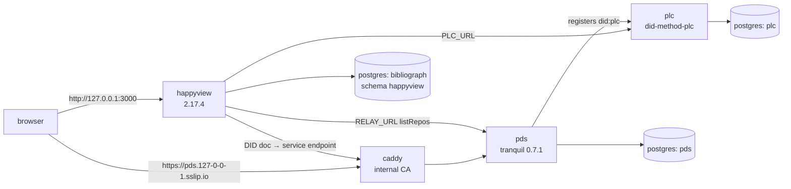

# HappyView (activity plane)

HappyView owns the `happyview` schema, indexes activity records, and serves the
activity queries. Locally it runs as a self-contained atproto network: its own
PLC directory and PDS, a Caddy that terminates TLS for the PDS, and no
dependency on `plc.directory` or any public relay.

The stack is `docker-compose.yml`; the tasks are `.mise/tasks/hv-*`.

## Topology



| Service | Host address | Notes |
| --- | --- | --- |
| `happyview` | `http://127.0.0.1:3000` | dashboard at `/`, redirects to `/dashboard/`; `/xrpc/*`, `/admin/*` |
| `pds` | `https://pds.127-0-0-1.sslip.io` | HTTPS only, via Caddy |
| `plc` | `http://127.0.0.1:2582` | `<did>` path returns the DID document |
| `caddy` | `:80`, `:443` | redirects 80→443; `*.pds.127-0-0-1.sslip.io` routes to the PDS |
| `postgres` | `127.0.0.1:5432` | databases `bibliograph`, `plc`, `pds` |
| `prometheus` | `127.0.0.1:9090` | unchanged from before HappyView |

## Pinned images

Pinned by **index digest**, not tag. `2.17.4` never moves, but `latest` on the
`pds-test` images does; a digest is the only pin that survives an upstream
rebuild.

| Image | Digest |
| --- | --- |
| `ghcr.io/gamesgamesgamesgamesgames/happyview` | `sha256:a981c30cb2bdad83413aa3126fb0eab6782427d0565f35e8b7349c098de2c841` |
| `ghcr.io/happyproto/pds-test/plc` | `sha256:6e61dc9c59d79cbc8b6cdcaac7464ae16258849ada92dd7cbbfc6d7979a81c3a` |
| `ghcr.io/happyproto/pds-test/tranquil` | `sha256:96f4ce1f9eec42ca17e4f6d693f6ae842ffe1618f97c9f51c5604116fb9483ed` |

`plc` is did-method-plc's own server, so the DIDs the PDS mints are real
`did:plc` DIDs that anything pointed at `PLC_URL` can resolve. `tranquil` is the
PDS implementation HappyView's own e2e suite runs.

## Bring-up

```bash
docker compose up -d                # postgres, plc, pds, caddy, happyview, prometheus
mise run hv-account                 # mint alice.pds.127-0-0-1.sslip.io
mise run hv-seed                    # make it superuser; write admin key + XRPC client
mise run hv-ca                      # trust Caddy's CA in Chrome and Firefox
```

On a volume created before the local network existed, `mise run hv-dbs` adds the
`plc` and `pds` databases. `docker/postgres-init.sql` does the same on a fresh
volume.

## Provisional account

| Value | |
| --- | --- |
| handle | `alice.pds.127-0-0-1.sslip.io` |
| password | `Dev-account-password1` (PDS login only) |
| DID | a `did:plc:…` registered in the local PLC — read it back with `mise run hv-seed` or `resolveHandle` |

`mise run hv-account` is idempotent. Password policy is the PDS's: at least one
uppercase letter and one digit.

`mise run hv-seed` runs `docker/seed-local-admin.sql`, which writes four kinds of
rows:

| Table | Row | Why |
| --- | --- | --- |
| `happyview_users` | the account DID, `is_super = 1` | dashboard admits only known DIDs; superuser can manage the instance |
| `happyview_user_permissions` | all 51 permissions | see below |
| `happyview_api_keys` | `hv_dev_admin` | `Authorization: Bearer` on `/admin/*` |
| `happyview_api_clients` | `hvc_dev_client` / `hvs_dev_secret` | `X-Client-Key` + `X-Client-Secret` on `/xrpc/*` |

The permissions are materialised on both the user and the key deliberately: the
API-key path computes `key.permissions ∩ user.permissions` and never consults
`is_super` (that short-circuit exists only for cookie sessions). A superuser
with no permission rows authenticates and then fails every request with
`Missing permission: <perm>`.

## Why each piece is shaped this way

These are not arbitrary; each one is the fix for a failure observed while
building the stack.

- **`PUBLIC_URL` is `http://127.0.0.1:3000`, a loopback name.** `is_loopback_url`
  then makes HappyView the spec's localhost OAuth client
  (`client_id=http://localhost?...`), so the PDS synthesises its client metadata
  instead of fetching it — TLS trust only has to work one way. The scheme must
  be `http`: with an `https` loopback URL HappyView panics at boot with
  `ClientMetadata(LocalhostClient(NotHttpScheme))`.
- **The PDS hostname is `pds.127-0-0-1.sslip.io`, not `pds.localhost`.** Handle
  domains cannot be under a reserved TLD; `createAccount` answers *"This
  server's handle domain has a reserved TLD"* for `.localhost` and `.test`.
  Every `*.127-0-0-1.sslip.io` name resolves to 127.0.0.1 through public DNS,
  so no `/etc/hosts` entry is needed, and Docker network aliases cover the
  container-to-container path.
- **`ALLOW_PRIVATE_FETCH=true` on the PDS.** The PLC is a compose-network
  address; without it the PDS's SSRF guard rejects its own DNS answer
  (`no resolved address for plc is inside the allowed host reach`) and account
  creation cannot register a `did:plc`.
- **`CRAWLERS=""` on the PDS.** Unset, it announces every new repo to eight
  public relays, which then try to crawl a hostname that resolves to their own
  loopback. Empty disables the service.
- **`ALLOW_PRIVATE_DESTINATIONS=true` on HappyView.** The PDS named in a DID
  document is a private address here, which HappyView otherwise refuses to
  connect to. It logs a warning at every boot while set.
- **Caddy's CA is installed inside the HappyView container**
  (`docker/happyview-local-entrypoint.sh`): HappyView fetches PDS authorization
  metadata and DID documents over TLS. The reverse direction is not needed,
  because of the loopback client above.
- **HappyView's healthcheck probes `/health` over bash's `/dev/tcp`.** The
  runtime image ships no `wget`, `curl`, `busybox` or `nc`, so the `wget`-based
  probe the upstream dev compose uses can never pass; this is the one from the
  published production compose.
- **Jetstream is closed** (`ws://127.0.0.1:1`) so no public records enter the
  index, and `RELAY_URL` points at the local PDS's `listRepos` so backfill can
  enumerate the local repo. Expect a `jetstream disconnected` warning a minute.
- **`happyview_app` has its own `search_path` (`happyview,public`)**, so
  HappyView's unqualified migrations and `db.raw` calls land in the `happyview`
  schema instead of colliding with the catalog's `public` tables.

## Calling it from the SvelteKit edge

Server-side only; HappyView is not the public origin. `packages/web` implements
this — `mise run web` serves the edge on `127.0.0.1:5176`, and
`src/lib/server/happyview.ts` is the only place that holds the client
credentials.

```ts
import { env } from "$env/dynamic/private";
const HAPPYVIEW = env.HAPPYVIEW_URL ?? "http://127.0.0.1:3000";

// Query
await fetch(`${HAPPYVIEW}/xrpc/net.olamaelcu.livtet.biblio.listShelves?did=${did}`, {
  headers: {
    "X-Client-Key": env.HAPPYVIEW_CLIENT_KEY!,
    "X-Client-Secret": env.HAPPYVIEW_CLIENT_SECRET!,
  },
});
```

- **The proxy owns the client identity.** Caller-supplied `X-Client-Key` and
  `X-Client-Secret` are never forwarded; the edge drops them and sets its own
  from env, so a browser cannot choose which client HappyView sees.
- **Queries** work anonymously. HappyView requires `X-Client-Key` only on
  *authenticated* (DPoP) requests, and an unknown key is a warning, not a
  rejection — so the header is there for rate limiting and caller attribution,
  not access control.
- **Procedures** need a user session, and the edge cannot supply one. The calling
  server's flow is: `POST /oauth/dpop-keys` (client key + secret), run OAuth
  against the PDS with the returned keypair, `POST /oauth/sessions`, then send
  `Authorization: DPoP <token>` plus a fresh `DPoP` proof on the proxied call.
  HappyView proxies the write to the PDS with its stored session.
- **Unknown methods return 502**, not 404. Do not map that to "upstream down".
- There is no `BASE_PATH`; routes are at the root. The previous deployment used
  `/~/hv`.
- The seeded client's `client_uri` is `http://127.0.0.1:5176`, so the dev server
  binds `127.0.0.1` (not `localhost`, which Vite resolves to `::1`, leaving the
  origin mismatched) on port 5176; the `Origin` check then stays quiet.
- `packages/web` runs SvelteKit 3 with Vite 8. Kit 3 rejects a
  `svelte.config.js` (`config_file_unsupported`) — adapter and server settings
  live in `vite.config.ts`, and runtime variables must be declared in
  `src/env.ts` with `defineEnvVars` or `$env/dynamic/private` will not expose
  them.

## Writes

HappyView never writes a repo. Records are written to the **PDS** by whoever
holds the user's session — the calling server (Livtet), not this edge, which
only relays credentials — and the AppView indexes what it can see:

| Path | Endpoint | Indexed immediately? |
| --- | --- | --- |
| App → PDS (normal) | `com.atproto.repo.{createRecord,putRecord,applyWrites}` on `https://pds.127-0-0-1.sslip.io` | no — needs Jetstream or backfill |
| App → HappyView procedure | `POST /xrpc/<nsid>` with a DPoP session | yes — `procedure.rs` upserts `happyview_records` after the PDS accepts the write |

Fifteen procedures implement the write side, so a client calls HappyView instead
of assembling records itself. Each is a lexicon (`type: procedure`) plus a
script at `xrpc.procedure:<nsid>`; the collection travels as `target_collection`
at upload, and a successful PDS write is indexed in the same request.

| Group | NSIDs |
| --- | --- |
| Follow graph | `graph.follow`, `graph.unfollow` — rkey is the subject DID, so a repeat is a no-op |
| Shelves | `shelf.create`, `shelf.update`, `shelf.delete` — delete cascades `shelfItem` and `bookStatus` rows that name the shelf |
| Membership | `shelf.addItem`, `shelf.removeItem`, `shelf.addBooks` — rkey `<shelf rkey>-<edition rkey>` |
| Reading status | `status.set`, `status.clear` — rkey is the edition rkey, metadata merges |
| Reader | `readingGoal.set` (rkey `current`), `profile.set` (rkey `self`) |
| Reviews | `review.create`, `review.update`, `review.delete` |

All fifteen answer `401 XRPC procedures require DPoP authentication` until the
caller presents a DPoP-bound session, because the write is proxied to the
caller's PDS. The edge holds no session of its own — it injects its XRPC client
identity and relays `Authorization` and `DPoP` untouched, so credentials are the
caller's responsibility (see Calling it from the SvelteKit edge).

The token in that session needs `transition:generic`: HappyView proxies the
write with it, and `atproto` alone grants no repo write. HappyView also refuses
a session whose scopes exceed its API client's registered ones, so the client is
registered for both.

Inline indexing was verified end to end while a local session harness existed:
`POST /xrpc/…shelf.create` returned the new shelf URI and `listShelves` included
it immediately, no backfill. Without such a session, the same data has to be
written to the PDS directly and backfilled — the sequence below:

```bash
# 1. write as the user (dev shape; in the app this is the user's OAuth session)
JWT=$(curl -sk -X POST https://pds.127-0-0-1.sslip.io/xrpc/com.atproto.server.createSession \
  -H 'content-type: application/json' \
  -d '{"identifier":"alice.pds.127-0-0-1.sslip.io","password":"…"}' | jq -r .accessJwt)

curl -sk -X POST https://pds.127-0-0-1.sslip.io/xrpc/com.atproto.repo.putRecord \
  -H "authorization: Bearer $JWT" -H 'content-type: application/json' \
  -d '{"repo":"did:plc:…","collection":"net.olamaelcu.livtet.biblio.shelf",
       "rkey":"dev-shelf","record":{"name":"Dev shelf","createdAt":"…","updatedAt":"…"}}'

# 2. the query still answers empty, because nothing told the AppView

# 3. index it
curl -X POST -H 'Authorization: Bearer hv_dev_admin' -H 'content-type: application/json' \
  -d '{"did":"did:plc:…","collection":"net.olamaelcu.livtet.biblio.shelf"}' \
  http://127.0.0.1:3000/admin/backfill
```

The job reports `completed` with `1` record and `listShelves` then returns the
shelf. Backfill walks `RELAY_URL` (`com.atproto.sync.listRepos` on the local
PDS), so it only ever sees the local network.

Do not point the app at HappyView for `com.atproto.repo.*`: those are built-in
lexicons, and HappyView proxies them to an authority DID that does not exist in
the local PLC (see Known limits).

### Record keys

The rkeys are part of the contract — the queries resolve records by them, so a
writer that invents its own scheme produces records nothing can read:

| Collection | rkey | Why |
| --- | --- | --- |
| `…biblio.bookStatus` | the edition record's rkey (last segment of the edition URI) | one status per edition per reader; a status change replaces the record. `getShelversOfBook` defaults to this derivation |
| `…biblio.shelfItem` | `<shelf rkey>-<edition rkey>` | one membership edge per (shelf, book), so re-adding is idempotent |
| `…biblio.readingGoal` | `current` | `getReadingGoal` reads `readingGoal/current` |
| `…actor.profile` | `self` | `getActorProfile` reads `actor.profile/self` |

`bookStatus.metadata.status` is required (`to-read`, `reading`, `read`, `dnf`).
Shelf membership and reading status are separate records on purpose: a book can
sit on several custom shelves while having exactly one reading status.

## Dashboard login

Open `http://127.0.0.1:3000`, redirects to `/dashboard/`, and sign in with the
provisional handle. The redirect chain goes to
`https://pds.127-0-0-1.sslip.io/oauth/authorize`, so the browser needs Caddy's
root CA first:

```bash
mise run hv-ca            # Chrome and Firefox (user stores, no sudo)
mise run hv-ca --system   # curl, openssl, wget (asks for sudo)
```

The redirect chain crosses to `https://pds.127-0-0-1.sslip.io/oauth/authorize`,
so the browser must trust Caddy's internal CA. `hv-ca` installs Caddy's root CA
into every store it finds, under the nickname `Caddy Local Dev CA`:

| Store | What it covers | Privileges |
| --- | --- | --- |
| `~/.pki/nssdb` | Chrome / Chromium | none |
| `~/.mozilla/firefox/*/cert9.db` | Firefox, per profile | none |
| `/usr/local/share/ca-certificates` (or p11-kit) | curl, openssl, wget, Node with `--use-system-ca` | sudo |

The browser stores need no privileges and are the default; the system store is
opt-in with `--system`. Restart the browser afterwards — it caches trust
decisions per session. `mise run hv-ca --uninstall` removes the certificate
again.

The account is already a superuser via `hv-seed`, so no post-login bootstrap
step is needed.

HappyView answers only hosts registered as domains; anything else gets `421
Unknown host` from `/config` and the dashboard renders blank. The primary domain
is `PUBLIC_URL` (`127.0.0.1:3000`), and `hv-seed` registers `localhost:3000` as
an alias so either spelling loads. A login *started* at `localhost:3000` still
returns to `127.0.0.1:3000/auth/callback`, because the loopback client's
redirect is built from `PUBLIC_URL` — use `127.0.0.1` when you intend to sign
in, or flip `PUBLIC_URL` and re-seed if you prefer `localhost` as canonical.

## Reset

```bash
docker compose down -v          # drops pgdata, pdsdata, caddy_data
docker compose up -d
mise run hv-account && mise run hv-seed && mise run hv-ca
```

To reset only HappyView's tables, drop the schema and **re-apply
`docker/postgres-init.sql` before restarting the container**: with the schema
missing, sqlx creates `_sqlx_migrations` in `public`, where `happyview_app` has
no `CREATE`, and the container crash-loops on `permission denied for schema
public`.

## Known limits

- **Built-in `com.atproto.*` proxy routes fail locally.** They resolve the
  lexicon's authority DID through `PLC_URL`, which is the local directory, so
  `com.atproto.server.describeServer` and friends answer
  `DID document not found for did:plc:6msi3p…`. Uploaded lexicons with their own
  Lua scripts are unaffected.
- **Six queries depend on `public.appview_book_lua`**, the catalog read model
  the deleted app owned. It still exists in this volume (the database predates
  the removal) and the catalog tables it reads are intact, so book-rendering
  queries work. `docker compose down -v` takes it with them; those queries would
  then answer 404 "catalog edition is missing" instead of rendering books.
- **The PDS validates against the *published* lexicons, not ours.** It resolves
  the NSID authority through DNS TXT (`_lexicon.livtet.olamaelcu.net` →
  `did:web:biblio.livtet.olamaelcu.net`) and fetches the schema from there. A
  collection it cannot find is accepted with `validationStatus: "unknown"`
  (`bookStatus` works), but a collection whose published schema disagrees with
  our local one is rejected: `follow` fails with
  `Invalid field 'subject': invalid format: AtUri`, because the published
  schema types `subject` as an at-uri while ours is a DID. Fixing that means
  republishing the lexicon at the authority — the local stack cannot override
  it.
- **`graph.follow` therefore cannot write locally**, until the published
  `follow` schema is corrected. `shelf.create`, `status.set` and the rest are
  unaffected.
- **The edge holds no user session.** `packages/web` injects its XRPC client
  key/secret and relays `Authorization`/`DPoP`; it never runs an OAuth flow or
  stores tokens. A caller that wants procedures must bring a DPoP session
  (Livtet registers its own with HappyView, or writes to the PDS directly), and
  the proxy cannot mint one on its behalf.
- **`db.raw` runs on the main connection** behind HappyView's tokenizer guard
  and logs a warning. Setting `PLUGIN_SQL_DATABASE_URL` to a least-privileged
  `happyview_plugin` role would move it to its own pool; no such role exists
  locally yet.
